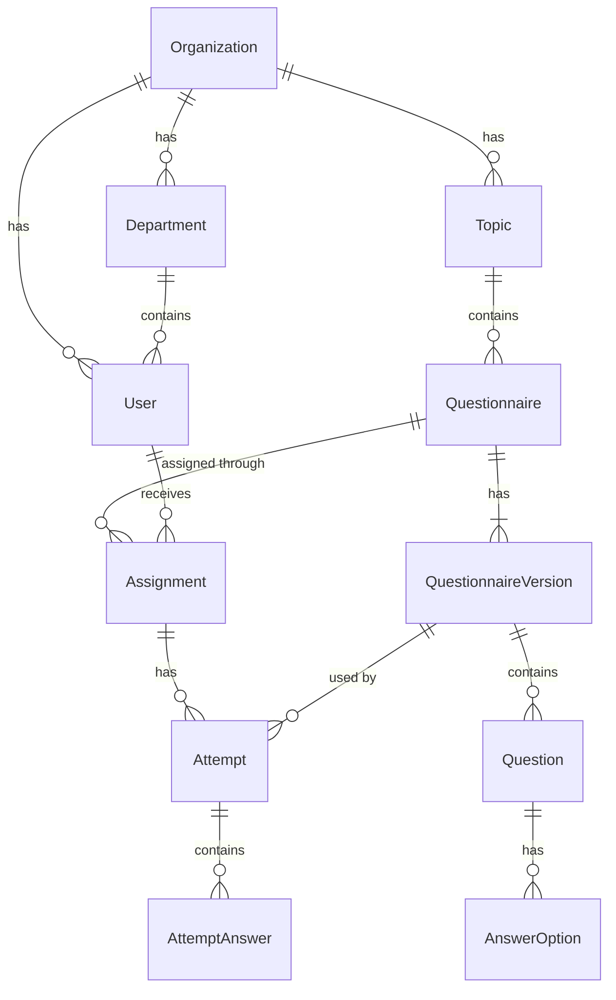

import SpecStatus from "/snippets/spec-status.mdx";

<SpecStatus />

## Entities

| Entity | Purpose |
| - | - |
| Organization | Owns all other records. The MVP has one organization, but the model supports many. |
| User | Administrator and employee accounts. |
| Role | Permissions for each kind of user. |
| Department | Groups employees. |
| Topic | A cybersecurity training subject, such as Phishing Awareness. |
| Questionnaire | A set of questions on one topic, with its settings. |
| Questionnaire Version | A snapshot of a questionnaire's questions. Created when a questionnaire with attempts is edited. |
| Question | One question in a questionnaire version. |
| Answer Option | A possible answer, and whether it is correct. |
| Assignment | Links a questionnaire to an employee, with a deadline. |
| Attempt | One try at completing an assignment, on one questionnaire version. |
| Attempt Answer | The answer chosen for each question in an attempt. |
| Notification | Messages to employees, such as new assignments and deadline reminders. |
| Audit Log | A record of important administrator actions. |
| Session | A signed-in session of one user, with its token. Lasts 8 hours. |
| Account Link | An invite or password reset link of one user, with its secret token. Never returned by the API. |

## Relationships

Every record belongs to an organization. The diagram shows only the main links to keep it readable.

See [Business rules](/developer-guide/business-rules) for how versions, statuses and attempts behave.

## Fields

The schemas in the [API spec](/api-reference/overview) are the source of truth. This section lists the same fields for reading; if the two ever disagree, the spec wins.

Every entity also has the shared fields below. They are not repeated in the tables.

| Field | Type | Notes |
| - | - | - |
| `id` | UUID | Unique identifier. |
| `organizationId` | UUID | The owning organization. Not on Organization itself. |
| `createdAt` | Timestamp | UTC, ISO 8601. |
| `updatedAt` | Timestamp | When the record last changed. |

Fields marked *derived* are calculated by the backend and cannot be set. "or null" means the field is always present and may be `null`.

### Organization

| Field | Type | Notes |
| - | - | - |
| `name` | String, 1–200 | Display name. |

### Role

| Field | Type | Notes |
| - | - | - |
| `key` | `administrator` or `employee` | Stable key. Users reference a role by its key. |
| `name` | String | Display name, for example "Administrator". |

### User

| Field | Type | Notes |
| - | - | - |
| `email` | Email, up to 254 | Sign-in address. Unique within the organization, ignoring upper and lower case. |
| `firstName` | String, 1–100 | |
| `lastName` | String, 1–100 | |
| `role` | Role key | `administrator` or `employee`. |
| `departmentId` | UUID or null | The user's department, if any. Only an active department can be chosen; a user keeps one that was deactivated later. |
| `status` | `active` or `inactive` | Inactive users cannot sign in, and their sessions end when they are deactivated. |
| `invitationSentAt` | Timestamp or null | When the latest invite link was sent. Sending the invite again sets it again. Null once the password is set. |
| `invitationExpiresAt` | Timestamp or null | 7 days after `invitationSentAt`. Null once the password is set. |
| `passwordSetAt` | Timestamp or null | When the user last set a password, through the invite link or a password reset. Null while the invite is pending or expired. |
| `invitationStatus` | `pending`, `expired` or `accepted` | *Derived.* `accepted` once `passwordSetAt` is set; otherwise `pending` until `invitationExpiresAt`, then `expired`. See [Invite links](/developer-guide/business-rules#invite-links). |
| `lastSignedInAt` | Timestamp or null | |
| `assignedTrainingCount` | Integer | *Derived.* Every assignment of the user, in any status. See [Training counts](/developer-guide/business-rules#training-counts). |
| `completedTrainingCount` | Integer | *Derived.* The user's assignments with the status Passed. |

### Department

| Field | Type | Notes |
| - | - | - |
| `name` | String, 1–100 | Unique within the organization, ignoring upper and lower case. |
| `description` | String or null | Up to 500 characters. |
| `status` | `active` or `inactive` | Inactive departments keep their history, and their employees keep their department. |
| `employeeCount` | Integer | *Derived.* Active users whose `departmentId` is this department. |

### Topic

| Field | Type | Notes |
| - | - | - |
| `name` | String, 1–100 | Unique within the organization, among active and inactive topics, ignoring upper and lower case. |
| `description` | String, 1–1,000 | Required. |
| `icon` | Topic icon or null | Optional Lucide icon name from the curated list `TopicIcon` in the spec, for example `fish`. |
| `status` | `active` or `inactive` | Inactive topics keep their history and their questionnaires' results. Employees do not see them. |
| `questionnaireCount` | Integer | *Derived.* Questionnaires whose `topicId` is this topic, active and inactive. |

### Questionnaire

| Field | Type | Notes |
| - | - | - |
| `topicId` | UUID | The topic it belongs to. |
| `title` | String, 1–200 | Not unique. |
| `description` | String or null | Optional, up to 2,000 characters. |
| `passingScore` | Integer, 1–100 | Percent needed to pass. Defaults to 80. |
| `timeLimitMinutes` | Integer, 1–480, or null | Optional time limit in minutes. Null means no limit. |
| `status` | `active` or `inactive` | A new questionnaire is inactive. Inactive questionnaires cannot be assigned. |
| `currentVersionId` | UUID | The latest version. New attempts use it. Set by the server: a new questionnaire gets an empty version 1. |
| `questionCount` | Integer | *Derived.* Questions in the current version. |

### Questionnaire Version

| Field | Type | Notes |
| - | - | - |
| `questionnaireId` | UUID | |
| `versionNumber` | Integer | Starts at 1 and goes up by one. |
| `questions` | List of Question | Returned nested, in display order. |

### Question

| Field | Type | Notes |
| - | - | - |
| `questionnaireVersionId` | UUID | The version it belongs to. |
| `position` | Integer | Display order, starting at 1. |
| `text` | String, 1–1,000 | |
| `explanation` | String or null | Optional feedback for a wrong answer. |
| `answerOptions` | List of Answer Option | At least two, exactly one correct. Returned nested, in display order. |

### Answer Option

| Field | Type | Notes |
| - | - | - |
| `questionId` | UUID | |
| `position` | Integer | Display order, starting at 1. |
| `text` | String, 1–500 | |
| `isCorrect` | Boolean | Sent to administrators. Employees get it only for a questionnaire they passed. |

### Assignment

| Field | Type | Notes |
| - | - | - |
| `questionnaireId` | UUID | |
| `userId` | UUID | The employee who must complete it. |
| `assignedById` | UUID | The administrator who assigned it. `createdAt` is the assignment date. |
| `dueAt` | Timestamp | The deadline. |
| `status` | Assignment status | *Derived.* `not_started`, `in_progress`, `passed`, `failed` or `overdue`. See [Assignment status](/developer-guide/business-rules#assignment-status). |
| `attemptCount` | Integer | *Derived.* |
| `latestScore` | Number or null | *Derived.* Score of the latest submitted attempt. |
| `completedAt` | Timestamp or null | *Derived.* When the passing attempt was submitted. |

### Attempt

| Field | Type | Notes |
| - | - | - |
| `assignmentId` | UUID | |
| `questionnaireVersionId` | UUID | The version the attempt used, from start to finish. |
| `attemptNumber` | Integer | 1 for the first attempt of the assignment. |
| `status` | `in_progress` or `submitted` | At most one attempt per assignment is in progress. |
| `startedAt` | Timestamp | |
| `expiresAt` | Timestamp or null | When the time limit runs out. Null without a time limit. |
| `submittedAt` | Timestamp or null | |
| `submissionType` | `employee`, `time_limit` or null | Who submitted: the employee, or the time limit automatically. |
| `passingScore` | Integer, 1–100 | The questionnaire's passing score when the attempt started, so later changes do not alter the result. |
| `questionCount` | Integer | Questions in the version. |
| `correctCount` | Integer or null | Null until submitted. |
| `score` | Number or null | Exact percent. Null until submitted. Shown rounded down. |
| `passed` | Boolean or null | Null until submitted. |

### Attempt Answer

| Field | Type | Notes |
| - | - | - |
| `attemptId` | UUID | |
| `questionId` | UUID | |
| `answerOptionId` | UUID or null | The chosen option. Null when the time limit ran out first. |
| `isCorrect` | Boolean or null | Null until the attempt is submitted. |

### Notification

| Field | Type | Notes |
| - | - | - |
| `userId` | UUID | The recipient. |
| `type` | `assignment_created` or `deadline_reminder` | The app builds the message text from the type. |
| `assignmentId` | UUID | The assignment it is about. |
| `readAt` | Timestamp or null | |

### Audit Log

Each entry is an `AuditLogEntry` in the spec. Entries are never changed. Which actions are logged, and what `changes` holds for each, is in [Business rules](/developer-guide/business-rules#audit-log).

| Field | Type | Notes |
| - | - | - |
| `actorId` | UUID | The signed-in administrator who did it. |
| `action` | `created`, `updated`, `deactivated` or `reactivated` | |
| `entityType` | `user`, `department`, `topic`, `questionnaire` or `assignment` | The kind of record. Employees are `user`. |
| `entityId` | UUID | The record the action was done to. |
| `changes` | List of `{ field, oldValue, newValue }` | What changed. Empty for deactivation and reactivation. |

`createdAt` is when the action happened.

### Account Link

An invite or password reset link. The backend keeps it to check the token in the link. The API never returns it: the link is emailed, and only its holder knows the token. Like a session, it belongs to a user, so it has no `organizationId`.

| Field | Type | Notes |
| - | - | - |
| `tokenHash` | String | A hash of the secret token in the link. The token itself is never stored. The mock keeps the token as it is, like session tokens. |
| `userId` | UUID | The user the link is for. |
| `purpose` | `invitation` or `password_reset` | What the link is for. |
| `createdAt` | Timestamp | When the link was sent. |
| `expiresAt` | Timestamp | 7 days after `createdAt` for an invite, 1 hour for a reset. |
| `usedAt` | Timestamp or null | When the link was used to set a password. A used link never works again. |

A new link removes the user's earlier links of the same purpose. See [Invite links and password resets](/developer-guide/business-rules#invite-links-and-password-resets).

### Session

Returned by the [authentication endpoints](/api-reference/overview#authentication). A session belongs to a user, not directly to the organization, so it has no `id`, `organizationId` or `updatedAt`.

| Field | Type | Notes |
| - | - | - |
| `token` | String | Opaque session token, sent as a bearer token. A secret. |
| `createdAt` | Timestamp | When the user signed in. |
| `expiresAt` | Timestamp | 8 hours after `createdAt`. |
| `user` | User | The signed-in user. |
