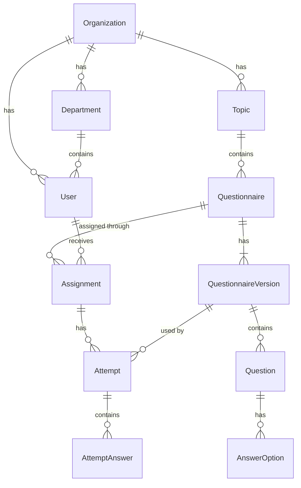

import SpecStatus from "/snippets/spec-status.mdx";

<SpecStatus />

## Entities

| Entity | Purpose |
| - | - |
| Organization | Owns all other records. The MVP has one organization, but the model supports many. |
| User | Administrator and employee accounts. |
| Role | Permissions for each kind of user. |
| Department | Groups employees. |
| Topic | A cybersecurity training subject, such as Phishing Awareness. |
| Questionnaire | A set of questions on one topic, with its settings. |
| Questionnaire Version | A snapshot of a questionnaire's questions. Created when a questionnaire with attempts is edited. |
| Question | One question in a questionnaire version. |
| Answer Option | A possible answer, and whether it is correct. |
| Assignment | Links a questionnaire to an employee, with a deadline. |
| Attempt | One try at completing an assignment, on one questionnaire version. |
| Attempt Answer | The answer chosen for each question in an attempt. |
| Notification | Messages to employees, such as new assignments and deadline reminders. |
| Audit Log | A record of important administrator actions. |

## Relationships

Every record belongs to an organization. The diagram shows only the main links to keep it readable.

See [Business rules](/developer-guide/business-rules) for how versions, statuses and attempts behave.

{/* TODO: fields for each entity will be added with the API spec. */}

Fields for each entity are defined in the API spec and will be listed here when it is written.
